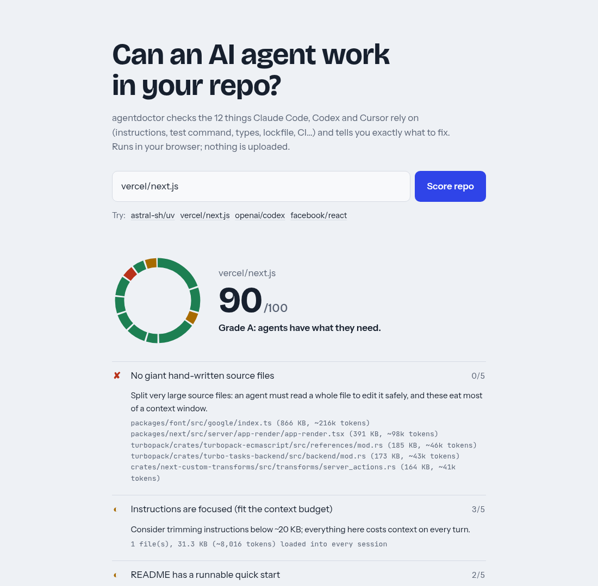

# agentdoctor

**Checks whether AI coding agents can work in your repo, 0-100, with the exact fixes.**

[](https://github.com/yassine-rebhi-dev/agentdoctor/actions/workflows/ci.yml)
[](docs/checks.md)
[](https://www.npmjs.com/package/agentdoctor)

```sh
npx agentdoctor
```

Or paste any public repo into the **[live demo](https://yassine-rebhi-dev.github.io/agentdoctor/)**. It runs in your browser, with no signup and nothing uploaded.

<picture>
  <source media="(prefers-color-scheme: dark)" srcset="docs/img/demo-dark.png">
  
</picture>

## Why this exists

Claude Code, Codex and Cursor do their best work when a repo tells them how to install, test and check their own
changes. Most repos don't. We scored the 93 most-starred AI code repos that hit GitHub Trending between July and
October 2026 ([full list](docs/leaderboard.md)):

- **28%** have no agent instructions file (`AGENTS.md`, `CLAUDE.md`, …) at the root.
- **43%** never tell the agent which commands to run.
- **31%** have no single command that runs the tests.

Each gap costs the agent turns, tokens and wrong guesses. agentdoctor finds them in seconds and tells you the fix.

## What it checks

Twelve checks, 100 points. Every result shows the evidence it found (file paths, commands) and, when it fails, what to change.

| Check | Points |
|---|---|
| Agent instructions file (`AGENTS.md`, `CLAUDE.md`, Copilot, Cursor, Gemini, Windsurf, Cline) | 20 |
| One discoverable test command | 15 |
| Instructions include runnable commands | 10 |
| Linter / formatter configured | 8 |
| CI runs on every change | 8 |
| Type checking available | 7 |
| Dependencies are locked | 7 |
| Instructions are focused (fit the context budget) | 5 |
| Build / dev commands are scripted | 5 |
| No giant hand-written source files | 5 |
| No committed `.env` | 5 |
| README has a runnable quick start | 5 |

How each one is detected, and why it matters to an agent: **[docs/checks.md](docs/checks.md)**.
agentdoctor only reads files. It never clones, installs or runs your code.

## Usage

```sh
npx agentdoctor                          # this directory (scores what git would commit)
npx agentdoctor vercel/next.js           # any public GitHub repo
npx agentdoctor --json                   # machine-readable report
npx agentdoctor --md                     # Markdown table for PR comments
npx agentdoctor --badge agentdoctor.svg    # self-contained SVG badge
npx agentdoctor --min-score 70           # exit 1 below 70
```

Remote repos use GitHub's public API: two requests per scan, 60 per hour without a token. Set `GITHUB_TOKEN` to
raise the limit; it is only ever sent to `api.github.com`.

### In CI

Fail the build when agent-readiness drops, and post the table to the job summary:

```yaml
# .github/workflows/agentdoctor.yml
name: agent-readiness
on: [pull_request]
jobs:
  agentdoctor:
    runs-on: ubuntu-latest
    steps:
      - uses: actions/checkout@v4
      - uses: actions/setup-node@v4
        with: { node-version: 22 }
      - run: npx -y agentdoctor --min-score 70 --md >> "$GITHUB_STEP_SUMMARY"
```

### As a library

```ts
import { score, GitHubSource } from "agentdoctor";

const report = await score(new GitHubSource({ owner: "astral-sh", repo: "uv" }));
console.log(report.score, report.results.filter((c) => c.status !== "pass"));
```

## How it differs

- **`claude /init` and similar commands write an instructions file.** agentdoctor measures the whole repo (tests,
  types, lockfile, CI, file sizes), gives a number you can gate on in CI, and works across agents.
- **Linters for instruction files** check the file itself. agentdoctor checks whether the repo around it lets an
  agent verify its work.
- **Zero runtime dependencies**, and the same core runs in the CLI and the browser.

## Limits

- It reads files; it does not run your tests, so it can't tell whether they pass.
- Content repos (awesome-lists, skill packs, tutorials) are detected and labelled, because test, type and lockfile
  checks are written for code projects.
- The weights are a judgment call, documented in [docs/checks.md](docs/checks.md). Disagree? Open an issue with a
  counter-example; wrong scores on real repos become regression tests.

## Contributing

See [CONTRIBUTING.md](CONTRIBUTING.md). New checks need a real failure mode, a detection rule and a false-positive
test against at least five well-known repos.

## License

MIT
